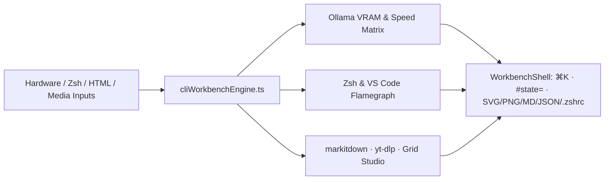

# cli-workbench

[](https://omakasekim.github.io/cli-workbench/)
[](#plugin-installation)
[](LICENSE)

> **`ollama` Local VRAM & Quantization Matrix, `ohmyzsh`/`vscode` Startup Flamegraph + Keybinding Collision Radar & `markitdown`/`yt-dlp`/Grid Studio**.

## Target GitHub Ecosystems

| Ecosystem | Capability in `cli-workbench` |
| --- | --- |
| `ollama/ollama` | Model × Quantization × Context Length × GPU/Apple Silicon VRAM & tok/s matrix with ready-to-run CLI flags |
| `ohmyzsh/ohmyzsh` · `microsoft/vscode` | Interactive lazy-load startup flamegraph, keybinding collision detector, and `.zshrc` prompt builder |
| `microsoft/markitdown` · `yt-dlp/yt-dlp` · `twbs/bootstrap` | HTML→Markdown LLM token-savings inspector, visual `yt-dlp` pipeline builder, and 12-col responsive ruler |

## Architecture



## Quickstart

```bash
npm install
npm run dev
```

Run tests and production build:

```bash
npm test && npm run build
```

## Plugin Installation

Run the zero-dependency local diagnostic CLI companion:

```bash
node plugin/cli.mjs --demo
```

## License

[MIT](LICENSE)
